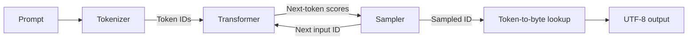

# Nathr

Nathr is an educational C++20 inference engine for the base SmolLM2-135M language model. It runs offline on x86-64 Linux, using local Safetensors or single-file GGUF v3 checkpoints. [Supported checkpoints and SHA-256 hashes](models/manifest.json)

The CLI can generate text, inspect checkpoints, tokenize prompts, and measure prefill and decode performance. The same engine is available as an embeddable C++ library. [Public API](include/nathr)

## How inference works



1. The model loader checks tensor sizes and shapes and binds weights by name. Safetensors weights are read into a shared model buffer. GGUF files are memory-mapped, and quantized weights stay in their packed format. [Safetensors loader](src/formats/safetensors.cpp) · [GGUF loader](src/formats/gguf.cpp)
2. The byte-level BPE tokenizer looks up byte tokens and merges neighboring tokens in the order specified by the model's merge table. The resulting IDs index the embedding table. [Tokenizer](src/tokenizer/tokenizer.cpp)
3. Each decoder block normalizes its input with RMSNorm and projects it to queries, keys, and values. Rotary position embeddings (RoPE) encode position in the queries and keys. Causal attention compares each query with keys at or before its position, then uses softmax to turn the scores into weights for the values. SmolLM2 shares three key/value heads across nine query heads. A SwiGLU feed-forward layer follows attention. The final output projection produces one score, or logit, per vocabulary token. [Decoder](src/models/llama/model.cpp) · [Attention](src/backend/cpu/scalar.cpp)
4. **Prefill** processes the prompt in chunks and saves each layer's keys and values. During **decode**, the sampler takes the highest logit or draws a token using temperature, top-k, and top-p. Nathr emits the token and appends it when another generation step is needed. Attention reuses the saved keys and values for earlier tokens. Generation ends at the end-of-sequence token or the token limit. [Sessions](src/runtime/session.cpp) · [Sampling and generation](src/runtime/generation.cpp)

## CPU execution and memory

Nathr selects kernels by tensor encoding. The automatic backend uses AVX2 kernels when supported and falls back to scalar kernels where needed. During prefill, a weight row can serve several tokens in a small tile. Decoding a single token uses row-wise dot products. [CPU kernels](src/backend/cpu/kernels.cpp)

Sessions share model weights and own a preallocated key-value (KV) cache, working memory, and random state. The cache size is proportional to the configured context capacity. At SmolLM2-135M's 8,192-token limit, it occupies 360 MiB in FP32 or 180 MiB in FP16. Attention reads FP16 entries as FP32 values. [Session allocation](src/runtime/session.cpp)

## Quick start

Build with CMake 3.25+, Ninja, and GCC 12+ or Clang 16+.

```sh
cmake --preset release
cmake --build --preset release
build/release/nathr generate "$MODEL" "Once upon a time"
```

Set `MODEL` to a GGUF file or a Safetensors directory containing `config.json`, `model.safetensors`, and `tokenizer.json`. Run `build/release/nathr --help` for options.

For C++ integration, install with `cmake --install build/release --prefix "$PWD/build/install"`. Set `CMAKE_PREFIX_PATH` to the install directory, call `find_package(nathr CONFIG REQUIRED)`, and link `nathr::nathr`.
