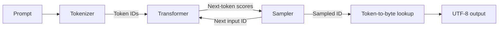

# Nathr

Nathr is an educational C++20 Transformer inference engine for x86-64 Linux. It runs GPT-2 and Llama-style text continuation, BERT encoding, and T5 text-to-text generation offline. [Example checkpoints and SHA-256 hashes](models/manifest.json)

The CLI exposes inference, checkpoint inspection, tokenization, and decoder benchmarking. The same engine is available as an embeddable C++ library. [Public API](include/nathr)

## Quick start

### 1. Set up Nathr

```sh
git clone https://github.com/MohamedElashri/nathr.git
cd nathr
./setup.sh
```

The script downloads and verifies the 92 MB GGUF checkpoint, builds Nathr, and runs the tests. [Prerequisites, other checkpoint options, and manual installation](#installation)

### 2. Generate text

Once setup prints `Ready`, run this from the `nathr` directory.

```sh
./build/release/nathr generate models/cache/SmolLM2-135M.Q4_0.gguf \
    "Once upon a time" --greedy --max-new-tokens 16
```

Nathr prints the continuation of the prompt.

```text
, the
people of the country were all very different. Some were farmers,
```

Replace the quoted prompt to try your own. [CLI options and examples](#cli-reference)

### Run GPT-2 small

From the repository root, run setup for GPT-2 small and pass the checkpoint directory to `generate`. The weights download is about 548 MB. [Pinned GPT-2 checkpoint](https://huggingface.co/openai-community/gpt2/tree/607a30d783dfa663caf39e06633721c8d4cfcd7e)

```sh
./setup.sh gpt2
./build/release/nathr generate models/cache/gpt2 "Once upon a time" --greedy --max-new-tokens 16
```

### Encode with BERT

The IDs encode `The sky is blue.` with BERT's boundary tokens. The output contains seven vectors of width 768.

```sh
./setup.sh bert
./build/release/nathr encode models/cache/bert-base-uncased \
    --tokens 101,1996,3712,2003,2630,1012,102 > build/bert-hidden.json
```

### Generate with T5

The input IDs encode `translate English to German: The sky is blue.`. The generated IDs decode to `Der Himmel ist blau.` with the checkpoint's tokenizer. [Use your own text](#tokenize-for-bert-and-t5)

```sh
./setup.sh t5
./build/release/nathr generate models/cache/t5-small \
    --tokens 13959,1566,12,2968,10,37,5796,19,1692,5,1 --greedy --max-new-tokens 12
```

## How inference works

GPT-2 and Llama-style models use a causal decoder to continue a prompt. [Inference engine guide](docs/inference-engine.md)



1. The model loader checks tensor sizes and shapes and binds weights by name. Safetensors weights are read into a shared model buffer. GGUF files are memory-mapped, and quantized weights stay in their packed format. [Safetensors loader](src/formats/safetensors.cpp) · [GGUF loader](src/formats/gguf.cpp)
2. The byte-level BPE tokenizer looks up byte tokens and merges neighboring tokens in the order specified by the model's merge table. The resulting IDs index the embedding table. [Tokenizer](src/tokenizer/tokenizer.cpp)
3. The decoder runs causal attention and a feed-forward layer in each block. Llama-style models use RMSNorm, rotary position embeddings (RoPE), and SwiGLU. GPT-2 uses LayerNorm, learned position embeddings, and GELU. Both produce one score, or logit, per vocabulary token. [Llama decoder](src/models/llama/model.cpp) · [GPT-2 decoder](src/models/gpt2/model.cpp) · [Shared attention](src/backend/cpu/scalar.cpp)
4. **Prefill** processes the prompt in chunks and saves each layer's keys and values. During **decode**, the sampler takes the highest logit or draws a token using temperature, top-k, and top-p. Nathr emits the token and appends it when another generation step is needed. Attention reuses the saved keys and values for earlier tokens. Generation ends at the end-of-sequence token or the token limit. [Sessions](src/runtime/session.cpp) · [Sampling and generation](src/runtime/generation.cpp)

**BERT** lets each token attend to the entire input and returns a hidden vector per token. **T5** encodes its source once, then generates with a causal decoder that also attends to the encoded source. [BERT encoder](src/models/bert/model.cpp) · [T5 encoder and decoder](src/models/t5/model.cpp)

## CPU execution and memory

Nathr selects kernels by tensor encoding. The automatic backend uses AVX2 kernels when supported and falls back to scalar kernels where needed. During prefill, a weight row can serve several tokens in a small tile. Decoding a single token uses row-wise dot products. [CPU kernels](src/backend/cpu/kernels.cpp)

Sessions share model weights and own their key-value (KV) cache, working memory, and random state. KV cache size grows with the configured context capacity. FP16 cache storage uses half the memory of FP32. [Session allocation](src/runtime/session.cpp)

## Model compatibility

Nathr reads dimensions, attention head counts, context length, and boundary token IDs from the checkpoint. Checkpoints can be up to 1 GiB with vocabularies of up to 65,536 tokens. Session capacity is also subject to the KV cache memory limit. [Session limits](src/runtime/session.cpp)

- **Llama-style.** Single-file GGUF v3 or Safetensors with RMSNorm, SwiGLU, unscaled full-width RoPE, and bias-free projections. [Llama configuration](src/models/llama/config.cpp)
- **GPT-2.** Dense, single-file Safetensors with the GPT-2 attention and GELU configuration. [GPT-2 decoder](src/models/gpt2/model.cpp)
- **BERT.** Dense, single-file Safetensors with absolute position embeddings and GELU. Encodes one unpadded sequence with segment ID zero and returns the last hidden states. [BERT encoder](src/models/bert/model.cpp)
- **T5.** Dense, single-file Safetensors for original ReLU T5. Uses an unpadded source and a greedy or sampled decoder with FP32 caches. Each sequence is capped at 512 positions or the checkpoint limit, whichever is smaller. [T5 model](src/models/t5/model.cpp)

The built-in tokenizer supports the byte-level BPE variants used by SmolLM2 and GPT-2. For GGUF, it reads the vocabulary, merges, and control tokens from metadata. Models with other tokenizers take IDs directly. [Built-in tokenizer](src/tokenizer/tokenizer.cpp) · [BERT and T5 tokenization](#tokenize-for-bert-and-t5)

## CLI reference

Run these commands from the repository root. Use a GGUF file or a directory containing `config.json` and `model.safetensors` as `MODEL`. Built-in text tokenization for Safetensors also uses `tokenizer.json`. You can write `--model PATH` and `--prompt TEXT` in place of the positional arguments.

```sh
nathr=./build/release/nathr
"$nathr" --help
"$nathr" --version
```

| Command | Options |
| --- | --- |
| `inspect MODEL` | Print checkpoint metadata and selected kernels as JSON. |
| `encode MODEL --tokens IDS` | Return one BERT hidden-state row per input token as JSON. |
| `tokenize MODEL PROMPT` | Use `--stages` to see pretokenization or `--stdin` to read one JSON string per line. Use `--tokens IDS` in place of the prompt to decode IDs and `--skip-special` to omit special tokens. |
| `forward MODEL --tokens IDS` | Report the highest-scoring next token from a decoder-only model. Use `--cached` to exercise the KV cache, `--json` to include the final logits, or `--trace FILE` to save activations. `--logits-f32` streams one little-endian FP32 row per token and is exclusive with `--json` and `--trace`. |
| `generate MODEL PROMPT` | Use `--tokens IDS` to supply IDs. For T5 these are source IDs and the output is always JSON. For decoder-only models use `--bos` to prepend a start token or `--json` for token IDs and metadata. Choose `--greedy` or tune sampling with `--temperature T`, `--top-k K`, `--top-p P`, and `--seed N`. `--max-new-tokens N` limits output (default 32). |
| `bench MODEL` | Report decoder-only prefill and decode timings as JSON. Set `--prompt-length N`, `--decode-length N`, `--warmups N`, and `--repetitions N` (defaults 128, 32, 2, and 7). |

Pass token IDs as comma-separated integers such as `1,7,2`. With a GGUF checkpoint, `tokenize` and `generate` accept `--tokenizer FILE` to supply a matching tokenizer.

Inference commands and `inspect` accept `--backend scalar|auto|avx2` and `--threads N` (1–64). The defaults are scalar execution and one thread. For cached decoder-only inference, `--context N` sets capacity, `--kv-cache f32|f16` selects cache precision, and `--prefill-chunk N` (1–32) sets the prompt chunk size. For T5, `--context N` sets decoder capacity, including the decoder start token.

### Examples

In the same shell, use the default SmolLM2 checkpoint from `./setup.sh`. The forward command takes the IDs returned by `tokenize`.

```sh
model=models/cache/SmolLM2-135M.Q4_0.gguf
"$nathr" inspect "$model"
"$nathr" tokenize "$model" "Once upon a time"
"$nathr" forward "$model" --tokens 6403,1980,253,655 --cached
"$nathr" bench "$model" --prompt-length 16 --decode-length 4 \
    --warmups 1 --repetitions 2 --backend auto
```

After `./setup.sh gpt2`, try sampling from GPT-2 with a fixed seed.

```sh
"$nathr" generate models/cache/gpt2 "Once upon a time" \
    --temperature 0.8 --top-k 40 --top-p 0.95 --seed 7 --max-new-tokens 8
```

### Tokenize for BERT and T5

After running setup for both checkpoints, use their `tokenizer.json` files with the optional Python `tokenizers` package. The tokenizer adds the checkpoint's special tokens.

```sh
python3 -m venv build/tokenizer-env
build/tokenizer-env/bin/pip install tokenizers
build/tokenizer-env/bin/python - <<'PY'
import json
import subprocess
from tokenizers import Tokenizer

def run(command, checkpoint, text, *options):
    model = f"models/cache/{checkpoint}"
    tokenizer = Tokenizer.from_file(f"{model}/tokenizer.json")
    ids = ",".join(map(str, tokenizer.encode(text).ids))
    output = subprocess.check_output(
        ["./build/release/nathr", command, model, "--tokens", ids, *options]
    )
    return tokenizer, json.loads(output)

_, bert = run("encode", "bert-base-uncased", "The sky is blue.")
print(len(bert["hidden_states"]), bert["hidden_size"])

tokenizer, t5 = run("generate", "t5-small", "translate English to German: The sky is blue.",
                    "--greedy", "--max-new-tokens", "12")
print(tokenizer.decode(t5["generated_ids"]))
PY
```

## Installation

### Prerequisites

Use x86-64 Linux with CMake 3.25+, Ninja, and GCC 12+ or Clang 16+. Cloning and downloading use Git, `curl`, and `sha256sum`. The setup script also uses Bash, Python 3 to read the checkpoint manifest, and `flock` from util-linux.

### Setup script options

Run `./setup.sh` or `./setup.sh gguf` for quantized SmolLM2, `./setup.sh safetensors` for the original weights, or `./setup.sh all` for both SmolLM2 formats. Use `./setup.sh gpt2`, `./setup.sh bert`, or `./setup.sh t5` for the other checkpoints. Setup stores checkpoints under `models/cache`, reuses verified files, and prints an inference command.

### 1. Build and test manually

From the repository root, run the build and tests. The tests use fixtures included in the repository.

```sh
cmake --preset release
cmake --build --preset release --parallel 2
ctest --preset release
./build/release/nathr --version
```

### 2. Download a model

Choose a SmolLM2-135M download below or use a model-specific setup command in Quick start. Each manual download block sets `model` to the path the CLI expects. Continue when every `sha256sum` check reports `OK`. [Supported downloads and SHA-256 hashes](models/manifest.json)

**GGUF (about 92 MB).** This single-file Q4_0 checkpoint includes the tokenizer and is the smaller download. [QuantFactory checkpoint](https://huggingface.co/QuantFactory/SmolLM2-135M-GGUF/blob/d948db3614be18259a175aafd7689a70f1cb4e2f/SmolLM2-135M.Q4_0.gguf)

```sh
model="$PWD/models/cache/SmolLM2-135M.Q4_0.gguf"
mkdir -p models/cache
curl --fail --location --retry 3 --output "$model" \
    'https://huggingface.co/QuantFactory/SmolLM2-135M-GGUF/resolve/d948db3614be18259a175aafd7689a70f1cb4e2f/SmolLM2-135M.Q4_0.gguf?download=true' &&
printf '%s  %s\n' '6f96e054a48f8fcdb5814abc1203ca12c0f9cce2791ca9a5153caad8c3b5479b' "$model" | sha256sum --check
```

**Safetensors (about 271 MB).** Download the original weights, configuration, and tokenizer into one directory. Pass that directory to Nathr. [Hugging Face checkpoint](https://huggingface.co/HuggingFaceTB/SmolLM2-135M/tree/93efa2f097d58c2a74874c7e644dbc9b0cee75a2)

```sh
model="$PWD/models/cache/SmolLM2-135M"
(
    set -e
    mkdir -p "$model"
    cd "$model"
    base_url='https://huggingface.co/HuggingFaceTB/SmolLM2-135M/resolve/93efa2f097d58c2a74874c7e644dbc9b0cee75a2'
    for file in config.json model.safetensors tokenizer.json; do
        curl --fail --location --retry 3 --output "$file" "$base_url/$file?download=true"
    done
    sha256sum --check <<'SHA256'
1d556eab73b69c7f11f64c557a2f9c6f440bd4c6b89bb2584a6b498c92603843  config.json
80521b40281d6ce74e35c9282c22539e75aa0ac8578892b2a59955ef78d55da1  model.safetensors
9ca9acddb6525a194ec8ac7a87f24fbba7232a9a15ffa1af0c1224fcd888e47c  tokenizer.json
SHA256
)
```

If a download or checksum fails, rerun that block. To use an existing checkpoint, set `model` to its absolute path. Use the file path for GGUF and the directory path for Safetensors.

### 3. Test the downloaded model

Run this in the same shell as the download block, with `model` pointing to the verified checkpoint. [More CLI examples](#examples)

```sh
./build/release/nathr generate "$model" "Once upon a time" \
    --greedy --max-new-tokens 32 --context 512 --backend auto
```

### Install locally (optional)

The CLI also runs directly from the build directory. To install the CLI and C++ library under the checkout without administrator access, run the following.

```sh
cmake --install build/release --prefix "$PWD/build/install"
./build/install/bin/nathr --version
```

Use `./build/install/bin/nathr` in place of `./build/release/nathr` in the commands above. To use the library from another CMake project, set `CMAKE_PREFIX_PATH` to the absolute path of `build/install`, call `find_package(nathr CONFIG REQUIRED)`, and link your target against `nathr::nathr`. [C++ API](include/nathr)

The included consumer example checks that a separate C++ project can find and run the installed library. It exits successfully without printing output. [Consumer source](tests/consumer/main.cpp)

```sh
cmake -S tests/consumer -B build/consumer -G Ninja \
    -DCMAKE_PREFIX_PATH="$PWD/build/install"
cmake --build build/consumer
./build/consumer/nathr-consumer tests/fixtures/model
```
