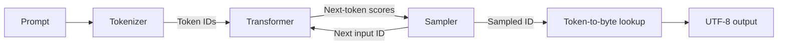

# Nathr

Nathr is an educational C++20 inference engine for small Llama-style language models. It runs offline on x86-64 Linux, using local Safetensors or single-file GGUF v3 checkpoints. The quick start uses the base SmolLM2-135M model. [Example checkpoints and SHA-256 hashes](models/manifest.json)

The CLI can generate text, inspect checkpoints, tokenize prompts, and measure prefill and decode performance. The same engine is available as an embeddable C++ library. [Public API](include/nathr)

## Quick start

```sh
git clone https://github.com/MohamedElashri/nathr.git
cd nathr
./setup.sh
./build/release/nathr generate models/cache/SmolLM2-135M.Q4_0.gguf "Once upon a time" --greedy
```

The setup script downloads and verifies the 92 MB GGUF checkpoint, builds Nathr, runs the tests, and checks generation. [Prerequisites, other checkpoint options, and manual installation](#installation)

## How inference works



1. The model loader checks tensor sizes and shapes and binds weights by name. Safetensors weights are read into a shared model buffer. GGUF files are memory-mapped, and quantized weights stay in their packed format. [Safetensors loader](src/formats/safetensors.cpp) · [GGUF loader](src/formats/gguf.cpp)
2. The byte-level BPE tokenizer looks up byte tokens and merges neighboring tokens in the order specified by the model's merge table. The resulting IDs index the embedding table. [Tokenizer](src/tokenizer/tokenizer.cpp)
3. Each decoder block normalizes its input with RMSNorm and projects it to queries, keys, and values. Rotary position embeddings (RoPE) encode position in the queries and keys. Causal attention compares each query with keys at or before its position, then uses softmax to turn the scores into weights for the values. SmolLM2 shares three key/value heads across nine query heads. A SwiGLU feed-forward layer follows attention. The final output projection produces one score, or logit, per vocabulary token. [Decoder](src/models/llama/model.cpp) · [Attention](src/backend/cpu/scalar.cpp)
4. **Prefill** processes the prompt in chunks and saves each layer's keys and values. During **decode**, the sampler takes the highest logit or draws a token using temperature, top-k, and top-p. Nathr emits the token and appends it when another generation step is needed. Attention reuses the saved keys and values for earlier tokens. Generation ends at the end-of-sequence token or the token limit. [Sessions](src/runtime/session.cpp) · [Sampling and generation](src/runtime/generation.cpp)

## CPU execution and memory

Nathr selects kernels by tensor encoding. The automatic backend uses AVX2 kernels when supported and falls back to scalar kernels where needed. During prefill, a weight row can serve several tokens in a small tile. Decoding a single token uses row-wise dot products. [CPU kernels](src/backend/cpu/kernels.cpp)

Sessions share model weights and own a preallocated key-value (KV) cache, working memory, and random state. The cache size is proportional to the configured context capacity. At SmolLM2-135M's 8,192-token limit, it occupies 360 MiB in FP32 or 180 MiB in FP16. Attention reads FP16 entries as FP32 values. [Session allocation](src/runtime/session.cpp)

## Model compatibility

The decoder reads dimensions, attention head counts, context length, and boundary token IDs from the checkpoint. It supports Llama models with RMSNorm, SwiGLU, unscaled full-width RoPE, and bias-free projections, within a 1 GiB checkpoint limit and a 65,536-token vocabulary limit. Session capacity is also subject to the KV cache memory limit. [Llama configuration](src/models/llama/config.cpp) · [Session limits](src/runtime/session.cpp)

Text input supports byte-level BPE with either the ByteLevel pretokenizer alone or individual-digit splitting followed by ByteLevel. For GGUF, Nathr reads the vocabulary, merge ranks, and control tokens from metadata. You can pass `--tokenizer /path/to/tokenizer.json` to supply a compatible matching tokenizer. Models with other tokenizers can use `forward --tokens` or `generate --tokens --json` with IDs from an external tokenizer. [Tokenizer](src/tokenizer/tokenizer.cpp)

## Installation

### Prerequisites

Use x86-64 Linux with CMake 3.25+, Ninja, and GCC 12+ or Clang 16+. Cloning and downloading use Git, `curl`, and `sha256sum`. The setup script also uses Bash, Python 3 to read the checkpoint manifest, and `flock` from util-linux.

### Setup script options

Run `./setup.sh safetensors` to prepare the original Safetensors checkpoint or `./setup.sh all` to prepare both formats. The script saves the checkpoints under `models/cache` and reuses files that match their SHA-256 hashes. It prints a generation command for each prepared model. Inference runs offline after setup.

### 1. Build and test manually

From the repository root, run the build and tests. The tests use fixtures included in the repository.

```sh
cmake --preset release
cmake --build --preset release --parallel 2
ctest --preset release
./build/release/nathr --version
```

### 2. Download a model

Choose either the GGUF file or the Safetensors directory. Both contain the base SmolLM2-135M model used for text continuation. Each block sets `model` to the path the CLI expects. Continue when every `sha256sum` check reports `OK`. [Supported downloads and SHA-256 hashes](models/manifest.json)

**GGUF (about 92 MB).** This single-file Q4_0 checkpoint includes the tokenizer and is the smaller download. [QuantFactory checkpoint](https://huggingface.co/QuantFactory/SmolLM2-135M-GGUF/blob/d948db3614be18259a175aafd7689a70f1cb4e2f/SmolLM2-135M.Q4_0.gguf)

```sh
model="$PWD/models/cache/SmolLM2-135M.Q4_0.gguf"
mkdir -p models/cache
curl --fail --location --retry 3 --output "$model" \
    'https://huggingface.co/QuantFactory/SmolLM2-135M-GGUF/resolve/d948db3614be18259a175aafd7689a70f1cb4e2f/SmolLM2-135M.Q4_0.gguf?download=true' &&
printf '%s  %s\n' '6f96e054a48f8fcdb5814abc1203ca12c0f9cce2791ca9a5153caad8c3b5479b' "$model" | sha256sum --check
```

**Safetensors (about 271 MB).** Download the original weights, configuration, and tokenizer into one directory. Pass that directory to Nathr. [Hugging Face checkpoint](https://huggingface.co/HuggingFaceTB/SmolLM2-135M/tree/93efa2f097d58c2a74874c7e644dbc9b0cee75a2)

```sh
model="$PWD/models/cache/SmolLM2-135M"
(
    set -e
    mkdir -p "$model"
    cd "$model"
    base_url='https://huggingface.co/HuggingFaceTB/SmolLM2-135M/resolve/93efa2f097d58c2a74874c7e644dbc9b0cee75a2'
    for file in config.json model.safetensors tokenizer.json; do
        curl --fail --location --retry 3 --output "$file" "$base_url/$file?download=true"
    done
    sha256sum --check <<'SHA256'
1d556eab73b69c7f11f64c557a2f9c6f440bd4c6b89bb2584a6b498c92603843  config.json
80521b40281d6ce74e35c9282c22539e75aa0ac8578892b2a59955ef78d55da1  model.safetensors
9ca9acddb6525a194ec8ac7a87f24fbba7232a9a15ffa1af0c1224fcd888e47c  tokenizer.json
SHA256
)
```

If a download or checksum fails, rerun that block. To use an existing checkpoint, set `model` to its absolute path. Use the file path for GGUF and the directory path for Safetensors.

### 3. Generate text

```sh
./build/release/nathr generate "$model" "Once upon a time" \
    --greedy --max-new-tokens 32 --context 512 --backend auto
```

Nathr prints the continuation after the prompt. With the Safetensors checkpoint it starts with `, there was a little girl named Lily.` The quantized checkpoint can produce different text. Replace the quoted prompt to try your own. `--greedy` picks the highest-scoring token at each step and `--max-new-tokens` limits the continuation. Raise `--context` for longer prompts or continuations, up to the model limit of 8,192 tokens. `--backend auto` selects the available CPU kernels.

### 4. Inspect and benchmark

```sh
./build/release/nathr inspect "$model" > build/model-info.json
./build/release/nathr tokenize "$model" "Once upon a time"
./build/release/nathr forward "$model" --tokens 6403,1980,253,655
./build/release/nathr bench "$model" --prompt-length 128 --decode-length 32 \
    --context 512 --backend auto --threads 4 --warmups 1 --repetitions 3
./build/release/nathr --help
```

`inspect` writes checkpoint metadata. `tokenize` should return IDs `[6403,1980,253,655]` for this prompt. `forward` takes those IDs and reports the highest-scoring next token ID. `bench` reports prefill and decode throughput on fixed inputs. The benchmark uses four CPU threads in this example.

### Install locally (optional)

The CLI also runs directly from the build directory. To install the CLI and C++ library under the checkout without administrator access, run the following.

```sh
cmake --install build/release --prefix "$PWD/build/install"
./build/install/bin/nathr --version
```

Use `./build/install/bin/nathr` in place of `./build/release/nathr` in the commands above. To use the library from another CMake project, set `CMAKE_PREFIX_PATH` to the absolute path of `build/install`, call `find_package(nathr CONFIG REQUIRED)`, and link your target against `nathr::nathr`. [C++ API](include/nathr)

The included consumer example checks that a separate C++ project can find and run the installed library. It exits successfully without printing output. [Consumer source](tests/consumer/main.cpp)

```sh
cmake -S tests/consumer -B build/consumer -G Ninja \
    -DCMAKE_PREFIX_PATH="$PWD/build/install"
cmake --build build/consumer
./build/consumer/nathr-consumer tests/fixtures/model
```
