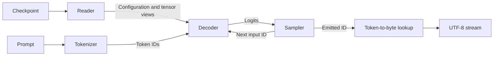

# Build a small LLM inference engine from scratch

This guide builds a small CPU inference engine for pretrained decoder-only Transformers. Start with fixed token IDs and a scalar forward pass. Then add a tokenizer, a key-value cache, and a generation loop. Keeping these pieces separate lets you swap checkpoints, test each operation, and add CPU optimizations without changing the model equations.

Nathr is the worked implementation. Its decoder covers a subset of the Llama architecture, and its tokenizer supports two byte-level BPE pipelines. The core interfaces below also apply when a different model family needs different layer equations, tensor mappings, or tokenization. SmolLM2-135M supplies concrete dimensions and a reproducible text example. [Nathr model compatibility](../README.md#model-compatibility)



## 1. Separate the checkpoint, model, and runtime

An inference engine evaluates the model with fixed weights. Given tokens `t[0]` through `t[p]`, the output at position `p` is a vector of next-token scores called *logits*. Index `i` in that vector corresponds to vocabulary token `i`. One forward pass can compute a logit vector at every position. For generation, the vector after the last input token is the one used to select the next token.

| Component | Responsibility |
| --- | --- |
| Checkpoint reader | Locate named tensors, their encodings, and metadata in a file or directory. |
| Model architecture | Interpret configuration, bind weight names and shapes, and define the forward pass. |
| Tokenizer | Map text to IDs and generated IDs back to bytes using the checkpoint's vocabulary and rules. |
| Session and generation | Track positions and mutable state, request logits, and sample the next ID. |
| CPU kernels | Evaluate operations on the tensors and encodings passed by the model. |

Choose one architecture and an accessible checkpoint first. List the operations the checkpoint requires, such as normalization, positional encoding, attention, and the feed-forward activation. Read the architecture name, dimensions, and options from its configuration, then validate them against your implementation before binding weights. Use a default for absent fields only when the architecture's format defines one. For example, Nathr's Llama loader uses the query-head count when the KV-head count is absent. It checks the head geometry, token ID range, and expected tensor shapes. [Nathr Llama configuration](../src/models/llama/config.cpp) · [Weight binding](../src/models/llama/model.cpp)

The worked decoder uses `L` layers, hidden width `H`, feed-forward width `F`, `Hq` query heads, and `Hkv` key/value heads. Each head has `D` coordinates. For the Llama geometry implemented here, `H = Hq * D`. Let `V` be the vocabulary size and `T` the context declared by the checkpoint. Keep session capacity and memory budgets separate from `T` so a model that supports a long context can run in a smaller session. [Nathr session limits](../src/runtime/session.cpp)

Use the logical weight shape `[output_width, input_width]`. A linear projection has one dot product per output row. The embedding table `[V, H]` maps a token ID to its initial activation. The output projection maps the final activation back to `V` logits. The following shapes describe the worked decoder.

| Projection | Weight shape |
| --- | --- |
| Query `Wq` | `[Hq * D, H]` |
| Key `Wk`, value `Wv` | `[Hkv * D, H]` each |
| Attention output `Wo` | `[H, Hq * D]` |
| Feed-forward gate `Wgate`, up `Wup` | `[F, H]` each |
| Feed-forward down `Wdown` | `[H, F]` |

For SmolLM2-135M, `L = 30`, `H = 576`, `F = 1536`, `Hq = 9`, `Hkv = 3`, and `D = 64`. That gives 576 query coordinates and 192 each for keys and values. `V = 49152` and `T = 8192`. These numbers describe the example checkpoint. The same equations operate on any dimensions that satisfy the decoder's shape rules. [SmolLM2-135M configuration](https://huggingface.co/HuggingFaceTB/SmolLM2-135M/blob/93efa2f097d58c2a74874c7e644dbc9b0cee75a2/config.json)

## 2. Read the checkpoint into tensor views

Represent a tensor with its element encoding, dimensions, and a read-only view of its bytes. Keep the backing storage alive as long as the model uses those views. Parse sizes with checked arithmetic, check tensor bounds before forming views, and reject unsupported encodings before execution. A format reader can expose tensors and metadata through this interface without knowing the decoder's layer equations. Nathr uses the same tensor view for two formats. [Nathr tensor view](../src/formats/tensor.hpp)

**Safetensors.** Read the eight-byte little-endian header length, parse the JSON header, and use each tensor's `data_offsets` to locate its half-open byte range relative to the start of the payload. Use checked arithmetic to compute the expected byte count from the shape and encoding. Nathr checks ranges for overlap, gaps, and bounds before it exposes any views, then loads the file into an owned buffer. FP32, FP16, and BF16 weights retain their stored encodings. The surrounding directory supplies `config.json` and `tokenizer.json` for text generation. [Safetensors format](https://github.com/safetensors/safetensors#format) · [Nathr loader](../src/formats/safetensors.cpp)

**GGUF.** Check the file signature and version, read typed metadata and tensor descriptors, and locate the aligned tensor data section. Tensor offsets are relative to that section. GGUF puts the fastest-varying dimension first, so a matrix's serialized dimensions read `[input_width, output_width]`. For packed encodings, validate each row against the block width and count bytes by blocks. Nathr uses a read-only mapping and retains metadata for the architecture declared by the file. The architecture loader interprets those fields. [GGUF specification](https://github.com/ggml-org/ggml/blob/master/docs/gguf.md) · [Nathr GGUF reader](../src/formats/gguf.cpp)

Bind tensor names and storage conventions in the architecture code. In Nathr's example, a Hugging Face Llama checkpoint calls its first query matrix `model.layers.0.self_attn.q_proj.weight`. The corresponding GGUF name is `blk.0.attn_q.weight`. Nathr also maps GGUF query and key projection outputs to the split-half order its rotary kernel expects. The original weight bytes stay in place. If the model ties its embeddings, the output projection reuses the embedding view. [Nathr weight binding](../src/models/llama/model.cpp) · [Rotary row mapping](../src/formats/tensor.hpp)

## 3. Implement a scalar forward pass

Begin with a small sequence of known token IDs and dense floating-point weights. A scalar FP32 projection can be written as follows. The caller supplies validated contiguous weights and an output buffer sized to the number of rows. FP64 accumulation followed by FP32 storage gives a straightforward reference. Nathr also decodes lower-precision weights as the kernel reads them. [Nathr scalar kernels](../src/backend/cpu/scalar.cpp)

```cpp
#include <cstddef>
#include <span>

void project_f32(std::span<const float> weights,
                 std::span<const float> input,
                 std::span<float> output) {
    for (std::size_t row = 0; row < output.size(); ++row) {
        const auto w = weights.subspan(row * input.size(), input.size());
        double sum = 0.0;
        for (std::size_t col = 0; col < input.size(); ++col) {
            sum += static_cast<double>(w[col]) * input[col];
        }
        output[row] = static_cast<float>(sum);
    }
}
```

With weight rows `[1, 2, 3]` and `[-1, 0, 4]` and input `[2, 1, -1]`, the output is `[1, -6]`. This case catches an accidental transpose or row-stride error before either gets into the Transformer. The rest of this section works through Nathr's Llama-style block. For a different architecture, use the layer order and operations expected by that checkpoint.

### Normalize and project

Each layer starts with a vector `x` of width `H` for every token. Root mean square normalization (RMSNorm) scales it using the root mean square of its coordinates and a learned gain vector `g`.

```text
scale = 1 / sqrt(sum(x[i] * x[i] for i in 0..H-1) / H + epsilon)
norm[i] = x[i] * scale * g[i]
```

Apply `Wq`, `Wk`, and `Wv` to the normalized vector. Split their outputs into heads of width `D`. Each head is a contiguous span, so head `h` begins at coordinate `h * D`.

### Rotate queries and keys

Rotary position embeddings (RoPE) rotate pairs of coordinates within each query and key head. For the split-half layout, pair coordinate `j` with `j + D/2`. Their angle is proportional to the zero-based absolute token position `p`. [RoFormer paper](https://arxiv.org/abs/2104.09864) · [Nathr rotary kernel](../src/backend/cpu/scalar.cpp)

```text
angle = p * theta^(-2*j/D)               for j in 0..D/2-1
(a, b) = (head[j], head[j + D/2])
head[j]       = a*cos(angle) - b*sin(angle)
head[j + D/2] = a*sin(angle) + b*cos(angle)
```

Precompute the inverse frequencies from `theta` when loading the model. Position zero is a useful test because the rotation is the identity there. Use the token's position in the full sequence during both prefill and decode. Values pass through unchanged.

### Compute causal grouped-query attention

For each query head at position `p`, compute a dot product with its corresponding key head at every position from `0` through `p`, inclusive. Grouped-query attention shares a key/value head across several query heads. With nine query heads and three key/value heads, query heads `0–2` use key/value head `0`, heads `3–5` use `1`, and heads `6–8` use `2`. [Llama 2 architecture](https://arxiv.org/abs/2307.09288) · [Nathr attention kernel](../src/backend/cpu/scalar.cpp)

```text
kv_head = query_head / (Hq / Hkv)        # integer division
score[i] = dot(query[p, query_head], key[i, kv_head]) / sqrt(D)
prob = softmax(score[0..p])
head_output = sum(prob[i] * value[i, kv_head] for i in 0..p)
```

Implement softmax by subtracting the largest score before exponentiation, then dividing each exponential by their sum. Scores `[0, ln(3)]` yield weights `[0.25, 0.75]`. If the value rows are `[4, 0]` and `[0, 8]`, the weighted output is `[1, 6]`. At position zero the output for each query head is simply its corresponding value head at position zero. Reuse one score buffer sized to the longest prefix the call or session can process, one query head at a time.

### Add the residuals and produce logits

Concatenate the attention heads, apply `Wo` to get a vector of width `H`, then add it to `x`. Normalize that sum with the layer's second RMSNorm gain. The feed-forward block computes two projections of width `F`, applies `SiLU(g) = g / (1 + exp(-g))` to the gate projection, and multiplies it element by element by the up projection. Apply `Wdown` and add a second residual. After the last layer, apply a final RMSNorm and multiply by the output matrix. SmolLM2-135M uses the embedding table for this final projection. [Layer execution and tracing](../src/models/llama/model.cpp)

The full uncached computation for a short token sequence looks like this in pseudocode. Each projection or normalization on two-dimensional activations applies to each token independently.

```text
x = embedding[token_ids]
for layer in layers:
    u = rms_norm(x, layer.input_gain)
    q = rope(project(layer.Wq, u), positions)
    k = rope(project(layer.Wk, u), positions)
    v = project(layer.Wv, u)
    a = causal_attention(q, k, v)
    x = x + project(layer.Wo, a)

    u = rms_norm(x, layer.ffn_gain)
    gate = silu(project(layer.Wgate, u))
    up = project(layer.Wup, u)
    x = x + project(layer.Wdown, gate * up)

return project(output_weights, rms_norm(x[last_position], final_gain))
```

This path can generate text by evaluating the whole prefix after each new token. It also gives you a reference for checking the cached path with the same input.

## 4. Turn text into token IDs

The model was trained with a specific tokenizer. Give the engine an entry point that accepts token IDs so you can check the decoder before implementing text input. For end-to-end generation, use the checkpoint's actual vocabulary, token IDs, and tokenization rules. A tokenizer with the same vocabulary size can still assign different IDs or split the same text differently.

Byte-level byte pair encoding (BPE) is one worked example. The serialized vocabulary uses a reversible byte alphabet. For example, it can represent ASCII space as `Ġ` (U+0120). Invert that mapping on load so each ID has a byte sequence. The merge list gives the priority of each pair and the vocabulary gives the ID of the merged token.

1. Recognize configured added tokens and copy their IDs directly. Split the remaining text into pieces using the checkpoint's pretokenizer, which defines where whitespace, digits, letters, and punctuation can be grouped.
2. For each piece, start with the vocabulary IDs for its individual UTF-8 bytes. Handle missing byte tokens according to the tokenizer's rules. Work on each piece independently to keep merges within pretokenizer boundaries.
3. Find the adjacent pair with the lowest merge rank. Resolve equal ranks by taking the leftmost pair. Replace it with its merged ID and repeat until no rule applies.
4. Emit the surviving IDs in order.

For a toy piece `abc`, suppose the rules say `b + c → bc` at rank `0` and `a + b → ab` at rank `1`. The first merge produces `[a, bc]`. The `a + b` rule can no longer apply because `b` is part of another token. A simple implementation rescans all pairs after each merge. Nathr links the surviving nodes, queues candidates by rank, and updates only the neighbors of a merge. Queued candidates carry node versions so stale pairs can be skipped. [Byte-level BPE implementation](../src/tokenizer/tokenizer.cpp)

Nathr loads the vocabulary and merge ranks from `tokenizer.json` or GGUF metadata. It supports ByteLevel on its own and individual-digit splitting followed by ByteLevel. For GGUF, control token types come from metadata alongside the token texts. If the caller supplies a matching `tokenizer.json`, called a sidecar, Nathr checks the complete vocabulary-to-ID mapping and ordered merges, and checks token types and pretokenizer behavior where it can compare them. A caller can also use an external tokenizer and pass its IDs to the decoder. [Nathr tokenizer loading](../src/tokenizer/tokenizer.cpp)

Check the IDs directly on prompts with leading spaces, newlines, digits, non-ASCII text, and special tokens. Check boundary IDs such as beginning-of-sequence (BOS) and end-of-sequence (EOS) separately from the rule that decides when to insert or stop on those IDs.

## 5. Keep past keys and values in a session

Causality means that appending token `p + 1` leaves the activations for positions `0..p` unchanged. For an attention-based decoder, save each layer's keys and values as you process tokens. The next query uses those stored vectors and the new token's Q, K, and V. When the model applies RoPE to Q and K, store the rotated keys so you can use them directly on later steps.

Share the immutable weights across sessions. Give each session its own cache, temporary buffers, token history, and random number generator. Nathr uses separate key and value banks indexed by `[layer][kv_head][position][coordinate]`. It allocates both banks at the configured capacity `C`. The token history records how many positions are in use. [Nathr cache layout](../src/backend/cpu/scalar.hpp) · [Session implementation](../src/runtime/session.cpp)

```text
KV bytes = 2 * L * Hkv * C * D * bytes_per_element
```

This formula assumes keys and values have the same head width and element size. Substitute the session capacity you intend to allocate. A full 8,192-token session for SmolLM2-135M uses 360 MiB for the FP32 cache or 180 MiB for FP16. Weights and temporary buffers are separate. Nathr defaults to a session capacity of up to 2,048 tokens. Its FP16 cache rounds on writes and converts back to FP32 on reads. Weight precision and cache precision can be chosen independently. [Nathr cache storage and attention](../src/backend/cpu/scalar.cpp)

**Prefill** runs the input prompt through the layers and fills the cache. Nathr evaluates groups of up to 16 tokens by default. A group can project and store all its keys and values before computing attention because a query at `p` reads only through `p`. Compute the vocabulary projection for the last prompt token when generating. Earlier prompt tokens still need to pass through all layers so their K and V can serve later tokens.

**Decode** processes each newly appended token at the current history length. Its queries attend to earlier cached entries and the new entry. The cache avoids recomputing earlier tokens' projections and layers. The new query still visits the entire prefix, so the attention work in each decode step grows with the occupied context.

Validate token IDs and remaining capacity before mutating the session. Nathr exposes logits after a successful forward call. A failure during execution can leave a partially written cache, so the session remains invalid until reset. Reset clears the logical history and restores the original random seed while retaining the buffers. [Session API](../include/nathr/nathr.hpp) · [Session state transitions](../src/runtime/session.cpp)

## 6. Sample tokens and stream text

Greedy decoding takes the maximum logit, with the first ID winning a tie. It is a convenient way to check the end-to-end model before introducing random sampling. For sampling, sort candidates by descending logit, keep the top `k` if specified, then compute weights with `exp((logit - max_logit) / temperature)`. Top-p retains the shortest prefix whose cumulative weight reaches `p` times the total weight of those candidates. Draw a uniform number over the retained weight mass and select the first token whose cumulative weight exceeds it. Nathr uses the session's seeded RNG for the draw. [Sampler implementation](../src/runtime/generation.cpp)

```text
session.prefill(prompt_ids)
for step in 0..max_new_tokens-1:
    id = sample(session.logits())
    emit(id)
    if id == eos or step + 1 == max_new_tokens:
        break
    session.append([id])
```

Use the checkpoint's EOS ID in the stopping rule. The logits at the end of prefill already predict the first new token. Appending a sampled ID computes logits for the following token. With `P` prompt tokens and a positive budget `N`, this loop needs room to consume at most `P + N - 1` tokens. Nathr reports the final emitted ID as `pending` so the caller can append it when resuming the session. [Nathr generation API](../include/nathr/generation.hpp)

Look up each emitted ID's byte sequence and pass it to an incremental UTF-8 decoder. A token can end with byte `C3`, and the next can start with `A9`. Together they encode `é`. The decoder holds incomplete bytes until another token arrives and emits a replacement character for invalid or unfinished input. The CLI uses this path to stream text and skips special tokens in the displayed output. [UTF-8 stream](../src/tokenizer/tokenizer.cpp) · [CLI generation](../apps/nathr.cpp)

## 7. Execute packed weights and make the CPU path faster

Add packed formats behind the row-dot interface. As a first implementation, unpack one block into a small local buffer, convert its values to FP32, and accumulate their products with the corresponding activation coordinates. Keep the full matrix packed in its backing storage. For a row of `N` weights, its byte stride is `N / elements_per_block * bytes_per_block`. Validate the divisibility when loading the tensor. [Tensor encodings](../src/formats/tensor.hpp) · [Scalar block decoders](../src/backend/cpu/scalar.cpp)

| Encoding | Block of 32 weights | Bytes per block |
| --- | --- | ---: |
| `Q8_0` | FP16 scale `d`, followed by 32 signed 8-bit integers | 34 |
| `Q4_0` | FP16 scale `d`, followed by 16 bytes containing two 4-bit values each | 18 |

`Q8_0` reconstructs a weight as `d * q`. In `Q4_0`, the low nibbles form the first 16 weights and the high nibbles form the second 16. A nibble `n` represents `d * (n - 8)`. With `d = 0.25` and the first packed byte `0xB2`, weights `0` and `16` are `-1.5` and `0.75`. A known byte pattern makes a useful test for sign conversion, nibble order, and scale decoding.

With one input token, a projection is a matrix-vector product. With several, a tile lets the kernel reuse each weight row across multiple input tokens. Nathr packs activation coordinates for up to 16 tokens next to each other within each column, then distributes sufficiently large ranges of output rows to a persistent worker pool. Each worker writes its own rows. The normalization, RoPE, attention, and feed-forward equations stay the same. [Projection and tiling](../src/backend/cpu/kernels.cpp) · [Worker pool](../src/backend/cpu/thread_pool.cpp)

Select kernels when binding the weights. On x86, check CPU feature bits and whether the OS saves the vector register state before entering AVX2 code. Nathr has AVX2 projection kernels for common encodings and a scalar path for other supported encodings or systems without usable AVX2. Its AVX2 FP16 projection also requires F16C for conversion. Compare optimized rows against the scalar version on ordinary lengths and tail sizes. [CPU dispatch](../src/backend/cpu/kernels.cpp) · [AVX2 kernels](../src/backend/cpu/x86/avx2.cpp)

## 8. Verify each interface before comparing generated text

Work outward from the first place results can diverge. Use an independent implementation or a small hand-computed case as a reference. A matching greedy token only checks the location of the maximum logit. Compare the entire vector to catch errors elsewhere in the output.

| Check | What to compare |
| --- | --- |
| Loader and kernels | Expected shapes and row values, including quantized blocks built from known bytes |
| Transformer | Embeddings, normalization, Q and K before and after RoPE, attention output, residuals, and logits |
| Cache | Cached and uncached logits for the same prefix, then logits after appending one fixed token at a time |
| Tokenizer | Token IDs and decoded bytes for the same prompt and special-token settings |
| Generation | Greedy IDs, EOS handling, context boundaries, and UTF-8 across token boundaries |

### Run the checks with Nathr

The checked-in FP32 fixture exercises both forward paths without downloading model weights. Run these commands from the repository root. [Build requirements](../README.md#prerequisites)

```sh
cmake --preset release
cmake --build --preset release
ctest --preset release

bin=build/release/nathr
fixture=tests/fixtures/model/f32
"$bin" forward "$fixture" --tokens 1,7,2 --json
"$bin" forward "$fixture" --tokens 1,7,2 --cached --prefill-chunk 1 --json
```

Both forward calls return 23 logits and a greedy ID of `2`. Compare the two `logits` arrays. The fixture tests compare full forward, chunked prefill, and repeated append. They also cover packed formats, malformed inputs, sampling, and allocation behavior. [Nathr runtime tests](../tests/runtime.cpp)

`forward --trace FILE` writes intermediate activations for a short sequence. `forward --logits-f32` streams one little-endian FP32 vocabulary row per token for comparisons against an independent implementation using the same checkpoint. Use exact comparisons when the operations and their numeric behavior match. When precision or reduction order differs, use a tolerance that accounts for the expected rounding error. [CLI forward command](../apps/nathr.cpp)

Once the numeric path agrees, try a full checkpoint. The following commands assume you downloaded the Q4_0 GGUF example to the path used in the README. To use the Safetensors example, set `model` to `models/cache/SmolLM2-135M` instead. [Model download instructions](../README.md#2-download-a-model)

```sh
model=models/cache/SmolLM2-135M.Q4_0.gguf
"$bin" tokenize "$model" "Once upon a time"
"$bin" generate "$model" "Once upon a time" --greedy --max-new-tokens 16
"$bin" bench "$model" --prompt-length 128 --decode-length 32 \
    --context 512 --backend auto --threads 4
```

The SmolLM2 tokenizer encodes `Once upon a time` as `[6403, 1980, 253, 655]`. These IDs give you a fixed input for comparing logits. The benchmark uses synthetic IDs to measure prefill and decode without tokenization or sampling. Keep the checkpoint, backend, thread count, context, cache precision, and input lengths fixed when comparing implementations. [Nathr benchmark](../apps/nathr.cpp)

## 9. Bring up a second checkpoint

Choose a checkpoint that differs in vocabulary size, head geometry, or context. For the same architecture, bind the tensors from its metadata and repeat the fixed-ID comparison. If it uses a different tokenizer, get reference IDs externally and check the decoder before enabling text input. Nathr can exercise compatible checkpoints this way with `forward --tokens` and `generate --tokens IDS --json`. Use IDs from the new checkpoint's tokenizer for those tests. [Nathr CLI](../apps/nathr.cpp)

For an architecture with different layer equations, add the configuration and weight binding rules alongside its forward pass. Define any additional state the session must carry. Reuse the tensor readers, sampling loop, and kernels whose interfaces still fit. Validate the new forward pass on a tiny fixture, then compare its uncached and cached outputs before testing a long continuation.
